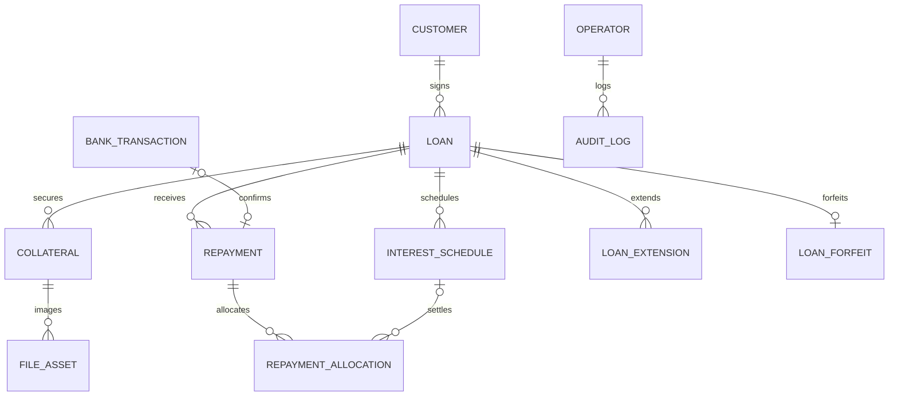

# 01. 아키텍처 및 핵심 비즈니스 규칙

## 1. 목표와 구성

- 설치형 전당포 관리 프로그램: Flutter Desktop UI + 로컬 Spring Boot API + SQLite
- 담보 이미지: Cloudflare R2. 오프라인 임시 보관/재동기화는 별도 설계
- 기능: 고객/계약/담보, 이자 일정, 수납, 입금 대사, 연장, 유질, 관리자, 대시보드, 계약서 PDF

## 2. 엔티티 목록

| Entity | 책임 | 우선순위 |
|---|---|---|
| Customer | 고객 식별 및 정보 | P0 |
| Loan | 계약 원금·금리·만기·종료 | P0 |
| Collateral | 계약별 담보물 | P0 |
| FileAsset | 담보 이미지 메타데이터 | P1 |
| InterestSchedule | 납기·청구액·상태 | P0 |
| Repayment | 실제 수납 사실 | P0 |
| RepaymentAllocation | 수납금 충당 | P0 |
| LoanExtension | 만기 연장 이력 | P0 |
| BankTransaction | 은행 거래 원본 및 대사 | P1 |
| LoanForfeit | 유질 확정 | P1 |
| Operator | 관리자 로그인·처리자 | P0 |
| AuditLog | 중요 변경 이력 | P1 |

## 3. 확정 업무 규칙

1. 최초 계약기간은 **1개월**. 최초 이자 납기일은 계약일의 1개월 후이자 최초 만기일이다.
2. 이후 연체 납부가 발생해도 **원래 계약 납기 주기를 유지**한다. 납부일/확인일을 기준으로 밀지 않는다.
3. 원금은 만기 일시상환, 부분 원금상환 불가.
4. 연장은 해당 기간 이자 및 연장 요건에 따른 미납액을 완납한 경우에만 가능.
5. 하나의 계약에 담보물 여러 개를 연결할 수 있다.
6. 실제 수납일(`receivedAt`)과 운영자 확인일(`confirmedAt`)을 별도 보존한다.
7. 운영상 6개월 연속 미납 시 유질 **검토** 대상. 자동 유질 확정은 금지하며 법적 요건 확인 필요.
8. 유질 후 감정사 인수·매입 운영정책을 가정하고 상세 매각 엔티티는 두지 않는다.
9. 입금 자동 매칭은 후보 판정과 확정을 구분한다. 입금액만 동일하다는 이유로 확정하지 않는다.
10. 수납·계약 변경 이력은 물리 삭제 대신 취소·정정 흔적을 보존한다.

## 4. 관계 개요

JPA는 `@ManyToOne` 단방향을 기본으로 사용하고, 실제 조회 요구가 있을 때만 양방향을 추가한다.

## 5. 타입 정책

- 화폐: Java `BigDecimal`; SQLite에는 원 단위 정수 등 정확성 있는 영속화 방안 검증
- 일자: `LocalDate`; 거래/확정 시각: `LocalDateTime`(타임존 정책 고정)
- 금리: 연율을 명시적으로 저장, `BigDecimal` 사용
- 법적 상한, 일할 계산, 반올림, 충당 순서: 구현 전 검증 및 확정 필요

## 6. 날짜 예시

| 사건 | 날짜 | 의미 |
|---|---|---|
| 최초 계약 | 1월 15일 | 최초 납기 2월 15일 |
| 납기 경과 | 2월 16일 | 미납 시 연체 |
| 실제 입금 | 2월 20일 | 수납액/연체금 정산 기준 |
| 운영 확인 | 2월 22일 | 확인 시각 별도 기록 |
| 후속 주기 | 3월 15일 | 유효한 연장 성립 시 다음 일정 |

**권장**: 1/31 → 2/28 → 3/31처럼 최초 계약일을 앵커로 삼아 월말 보정.
